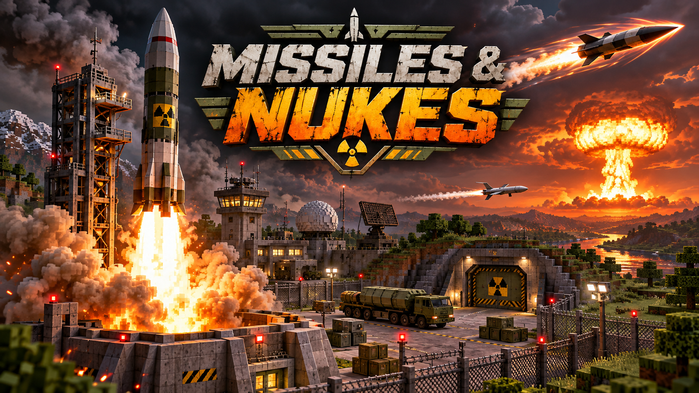

# Mine Mods



A collection of Minecraft mods by **Anuj Mhatre**, for **Minecraft Java** with Forge and NeoForge. Each mod lives in its own folder with full source code and, where available, a ready-to-install jar.

## Mods

| Mod | Folder | Description | Jar |
|-----|--------|-------------|-----|
| **Missiles & Nukes** | [`missilesnukes/`](missilesnukes/) | Light and Heavy ICBMs with a real flight simulation, physical stage separation, crater-forming warheads and an 8-slot launch remote. Built from Create components. **Requires Create.** | [`missilesnukes-1.0.0.jar`](missilesnukes/missilesnukes-1.0.0.jar) |
| **Custom Jetpack** | root | Jetpack item with a custom GeckoLib model and Curios back-slot support. | build from source |
| **Runic Titan v2** | [`runic-titan-v2/`](runic-titan-v2/) | Runic Titan gameplay with the Earthshaker hammer, thrown-hammer rendering and meteor impact VFX. | build from source |
| **Transport Truck** | [`transport-truck/`](transport-truck/) | Two-seat off-road cargo truck with 54 cargo slots. **Minecraft 1.20.1 / Forge 47.3 or later in 47.x.** | [`transport_truck-1.0.0.jar`](transport-truck/transport_truck-1.0.0.jar) |
| **Transport Golem** | [`transport-golem/`](transport-golem/) | Rideable transport golem entity with seating, jump and smash actions. | build from source |

## Installation

1. Use the Minecraft version and mod loader listed for your mod. Transport Truck uses **Minecraft 1.20.1 and Forge 47.x (47.3 or later)**. The NeoForge mods in this collection use **Minecraft 1.21.1 and NeoForge 21.1.x**.
2. Install required dependencies for the mod you want (Create 6.x for Missiles & Nukes, plus Flywheel etc.).
3. Drop the mod `.jar` into your `.minecraft/mods` folder.
4. Launch the game.

## Building from source

For the NeoForge mods, use **JDK 21** and internet access (Gradle downloads NeoForge and Minecraft on first build). For Transport Truck, use **JDK 17** and follow its [build instructions](transport-truck/README.md#build).

```bash
cd missilesnukes   # or runic-titan-v2 / transport-golem
./gradlew build    # Windows: gradlew.bat build
```

Built jars appear in `build/libs/`.

## Notes

* **Missiles & Nukes** is functionally complete but has not been compiled or run in a live Minecraft client yet; build it locally first.
* Always back up your worlds before testing work-in-progress mods.
* Code is All Rights Reserved unless a mod folder states otherwise.
