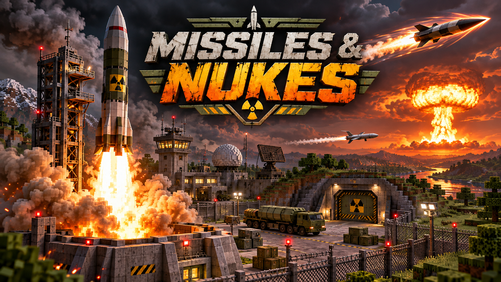

# Missiles & Nukes  (Minecraft Java 1.21.1 · NeoForge 21.1 · Create required)




Two missile types built from your resource packs (**Light ICBM** and **Heavy ICBM**), with a real flight simulation,
physical stage separation, crater-forming warheads and an 8-slot launch remote.

> **Status.** The Minecraft-facing code (entities, renderers, GUI, networking) was written against the real NeoForge
> 21.1 / Create 1.21.1 sources and signature-checked, **but it has not been compiled or run in Minecraft yet**: the
> environment it was written in cannot reach Mojang's or NeoForge's servers. The simulation and model code *were* compiled
> and tested for real (see "What was verified"). Expect to build it once locally; if the compiler reports anything, send
> me the output and I will fix it.

## Build

Requirements: **JDK 21** and internet access (Gradle downloads NeoForge/Minecraft on first build).

```
./gradlew build            # Windows: gradlew.bat build
```

The mod jar is `build/libs/missilesnukes-1.0.0.jar`.

## Install

1. A Minecraft 1.21.1 instance with **NeoForge 21.1.x** (21.1.267 or newer).
2. **Create 1.21.1** (6.x) plus the libraries its download page lists (Flywheel etc.). Create is a *required* dependency:
   the game will refuse to start this mod without it.
3. Put `missilesnukes-1.0.0.jar` into the instance's `mods` folder.

To run from Gradle instead (`./gradlew runClient`), copy the Create, Flywheel, Ponder and Registrate jars into `libs/`.

## Crafting (exactly as supplied; nothing added or changed)

| Item | Pattern (row by row) |
|---|---|
| Central Body | Iron Sheet · Copper Sheet · Iron Sheet / Copper Sheet · **Fluid Tank** · Copper Sheet / Iron Sheet · Copper Sheet · Iron Sheet |
| Engine Mount | Iron Sheet · **Sturdy Sheet** · Iron Sheet / Iron Sheet · **Blaze Burner** · Iron Sheet / Iron Sheet · Sturdy Sheet · Iron Sheet |
| Warhead | Iron Sheet · TNT · Iron Sheet / Iron Sheet · Blaze Rod · Iron Sheet / Iron Sheet · Redstone Block · Iron Sheet |
| Missile | Iron Sheet · Warhead · Iron Sheet / Iron Sheet · Central Body · Iron Sheet / Iron Sheet · Engine Mount · Iron Sheet |
| Launch Remote | Iron Nugget · Oak Button · Iron Nugget / Oak Button · Redstone Dust · Oak Button / Iron Nugget · Oak Button · Iron Nugget |

Sheets, Fluid Tank, Sturdy Sheet and Blaze Burner are Create items (`create:iron_sheet`, `create:copper_sheet`,
`create:sturdy_sheet`, `create:fluid_tank`, `create:blaze_burner`). The fuel tank is part of the Central Body.

## Missile types

| | Light ICBM | Heavy ICBM |
|---|---|---|
| Models | `light_icbm_*` (single-mesh missile, cut at the stage seams) | `heavy_icbm_*` (three separate stage meshes placed by node offsets, embedded animated thruster) |
| Height / width | 4.0 / 0.7 blocks | 6.4 / 1.0 blocks |
| Wet mass (engine+body+warhead+fuel) | 90 + 260 + 200 + 640 | 160 + 520 + 420 + 1500 |
| Engine | thrust 86, exhaust speed 22, spool-up 40 ticks | thrust 170, exhaust speed 26, spool-up 60 ticks |
| Max range (propellant limited) | about 3000 blocks | about 5000 blocks |
| Blast | crater radius x1.0 | crater radius x1.6 (also larger shockwave and sound) |
| Crafting | recipes from your TXT files | **none yet** (Creative tab / `/give` only). Planned: same patterns as Light, with 5 TNT in the warhead (needs the custom bench) |

All numbers are in `sim/MissileSpec.java`; the two types are simulated by exactly the same physics. The Heavy values are my
own design choices (you gave models, not stats): change them in that one file.

Item ids (for `/give` and for the recipes you will send later):
`missilesnukes:light_icbm_central_body`, `..._engine_mount`, `..._warhead`, `..._complete_missile`, `..._launch_remote`,
`missilesnukes:heavy_icbm_central_body`, `heavy_icbm_engine_mount`, `heavy_icbm_warhead`, `heavy_icbm_complete_missile`.
The remote's 8 slots accept either type, mixed freely.

**Heavy item icons:** the four heavy items use your preview images as their inventory / hotbar / creative-tab texture
(`assets/missilesnukes/textures/item/heavy_icbm_*.png`: background removed, fitted to a 64x64 square, the two tall parts tilted 45 degrees).
Held, dropped and item-frame views still use the 3D models. The original screenshots are kept in `docs/reference/`.

## Playing

1. Right-click the **top of a block** with a Missile: it stands upright as a launch-ready missile. Shift + empty hand picks it back up.
2. Right-click a missile with the **Launch Remote** to link it to the remote's selected slot (or press LINK in the panel).
3. Right-click with the remote in the air to open the control panel (compact 224x200; it also scales with Minecraft's GUI Scale setting).
   * **Pads 1–8** are eight independent slots, each with its own missile, target, state and status LED
     (grey empty · amber linked · green ready · orange in flight · violet detonated · red no signal / no solution).
     Click or press keys **1–8** to select; **Shift+click** arms a slot for a simultaneous launch.
   * **X Y Z** is the block under the impact point. **AIM** copies the block you are looking at (up to 512 blocks), **HERE** your position,
     **SET TARGET** stores it. The panel runs the real simulation to show range, flight time, apogee and whether it is reachable.
   * **LAUNCH** fires the selected slot (or every armed slot at once); **LAUNCH ALL READY** fires every ready slot in the same tick.
   * **FX** switches the thruster flame and exhaust ON/OFF for the selected missile, also during flight.
   * While the remote is held, a HUD shows the 8 LEDs and live stage, altitude, speed, distance and ETA of the selected slot.

## How the flight works (no scripted animation)

Everything comes from one deterministic simulator (`sim/FlightSim`), shared by the server, the panel preview and the guidance:

* **Ignition & liftoff:** thrust spools up; the missile is held on the pad until thrust exceeds its weight.
* **Powered ascent:** vertical climb, then a pitch-over towards the target; thrust, mass flow (fuel burns off), gravity,
  altitude-dependent air drag and inertia are integrated every tick. The target's X/Y/Z set the heading, burnout angle (steep for
  short shots, flatter for long ones), apogee, travel distance and flight time.
* **Engine cutoff:** closed-loop guidance repeatedly predicts the landing point and cuts the engine at exactly the right moment
  (bisecting inside the final tick), so the cutoff time is a result of the physics, not a timer.
* **Propulsion separation:** the engine section unlatches once residual thrust has died away *and* dynamic pressure is low enough.
  Spring impulse is split by momentum conservation. The engine section becomes its own entity that tumbles and falls.
* **Warhead separation:** at apogee. The spent central body becomes its own entity; the warhead flips nose-first and descends.
* **Impact:** swept collision test (no tunnelling) → explosion effect, expanding shockwave (damage + knockback) and a bowl-shaped crater
  carved layer by layer over several ticks (no server stall). Crater radius, damage, block damage and more are in the server config.
* Missiles keep their chunks loaded along the path so long flights continue with nobody nearby; all state is saved with the world.

## Config (`serverconfig/missilesnukes-server.toml`)

`craterRadius`, `craterBlocksPerTick`, `craterMaxBlastResistance`, `blockDamage`, `respectMobGriefingRule`, `shockwaveMaxDamage`,
`shockwaveRadiusFactor`, `debrisBlockDamage`, `chunkLoading`.

## What was verified

Run `tools/run-checks.sh` (needs only a JDK and a gson jar) to repeat all of these:

* Flight simulation, for BOTH missile types: 400 random targets each (any direction, mountains and valleys): worst miss 0.24 block, mean 0.01. Events fire once each
  in the right order; live stepping matches the dry run to the tick; timings differ per shot (cutoff 95–174 ticks, separation gap 23–29 ticks);
  every azimuth gives identical timings; rejection of too-close / out-of-range / unreachable targets.
* 8 missiles of mixed types (4 light, 4 heavy) launched in the same tick at different ranges/bearings: each lands on its own target, ~0.005 ms per missile per tick.
* glTF reader on your real GLBs (13,176 triangles, 217- and 212-channel animations, PNG textures); the stage splitter conserves surface
  area to 1e-8; the flame hangs at the nozzle. Heavy model: stage meshes are vertex-identical to your standalone part files, the
  assembled height (6.392) matches the spec, centres of mass match, and its flame hangs from the nozzle.
* The five light-set recipes are generated from your TXT files; all twelve GLBs in the mod are byte-identical to yours.
* Every NeoForge/Create API and item id used was checked against their 1.21.1 source; the whole project passes `javac` parsing and
  cross-reference checks except for the missing Minecraft jars.

## Not verified yet (needs a real build / game)

Compilation against Minecraft, in-game visuals (held-item pose in first/third person, GUI layout), multiplayer behaviour,
and long-flight chunk loading on a real server.

## Notes and assumptions

* Vanilla's renderer only uses base-colour textures, so the models' normal and metallic-roughness maps are not shown (geometry, base
  colours, emissive parts, transparency and all animations are preserved).
* The assembled missile is a single mesh, so it is cut at two planes (y = -1.495 and 0.785) with exact triangle clipping to form
  engine mount, central body and warhead; separated stages are open shells.
* "Thruster ON/OFF" switches the visual effect (flame model + exhaust particles); the engine physics still run.
* Maximum range is limited by the propellant in the tank (about 3000 blocks Light, 5000 Heavy); a high target shortens it slightly.
