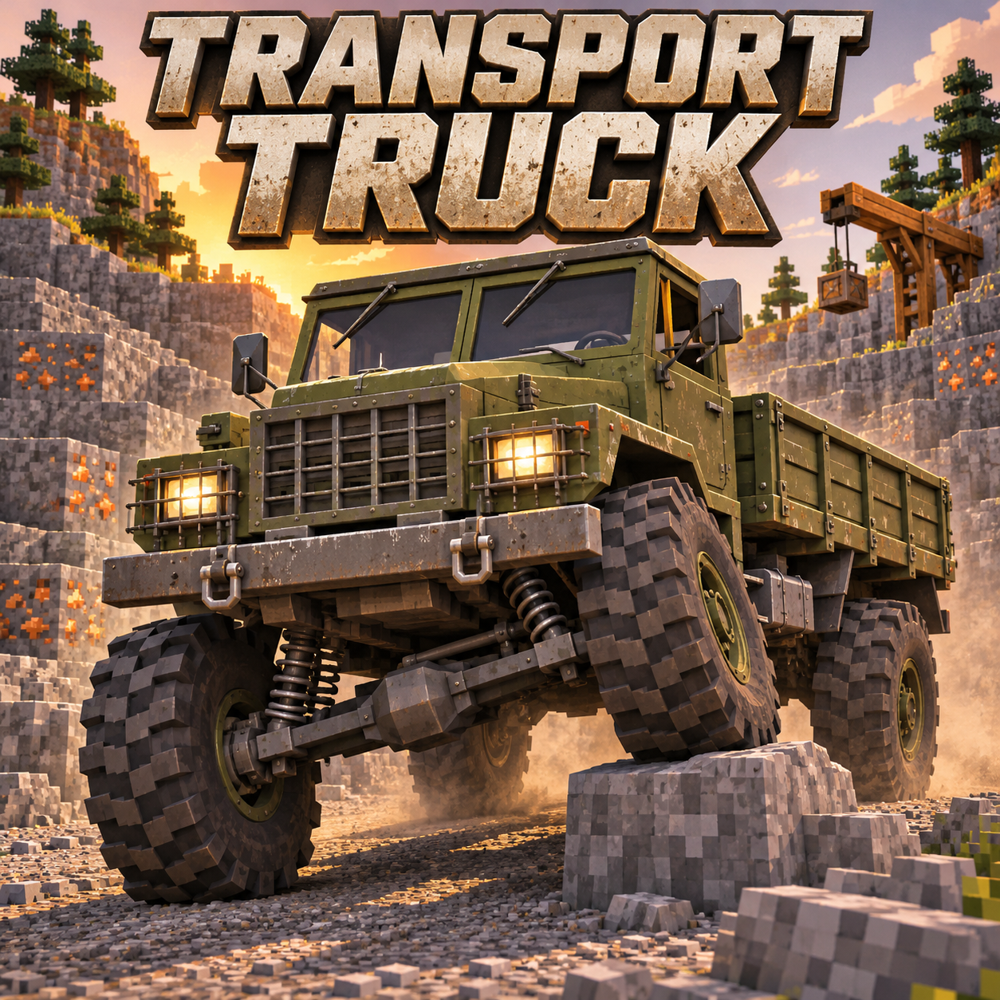

# Transport Truck

A two-seat 4×4 cargo truck for Minecraft Java 1.20.1 with Forge 47.x starting at 47.3 and Java 17. The project pins Forge 47.3.0 and uses official Mojang mappings.

## Install

1. Use a Minecraft 1.20.1 Forge profile version 47.3 or later in the 47.x series, including 47.4.20.
2. Download [Transport Truck 1.0.0](transport_truck-1.0.0.jar) and copy it into the profile's `mods` folder. Use the same JAR on a multiplayer server and its clients.
3. Start Forge. Use the Transport Truck creative tab or run `/truck spawn` with operator permissions and clear space ahead.

## Drive

Right-click to board, driver first then passenger. Shift dismounts. W accelerates, S brakes then reverses, A/D steer and Space applies the handbrake. F5 switches camera. H sounds the horn, R opens cargo, and G folds the side wings. J, K and L toggle the hood, driver's door and passenger door when stopped. Rebind these keys under **Options → Controls → Key Binds → Transport Truck**.

Shift + right-click outside the truck to open its 54 slots. Right-click with an iron ingot to repair 20 health. A pickaxe picks up the truck and drops its cargo. Coal or charcoal adds fuel when enabled. Edit `config/truck-common.toml` for fuel, top speed in metres per second, and damage.

| Crafting row | Left | Centre | Right |
| --- | --- | --- | --- |
| Top | Black wool | Iron ingot | Black wool |
| Middle | Furnace | Chest | Iron block |
| Bottom | Black wool | Iron ingot | Black wool |

## Build

On Java 17, run `gradlew.bat build` on Windows or `./gradlew build` on Linux and macOS. The installable JAR is in `build/libs`. The initial build downloads dependencies. Use `./gradlew runClient` for a development client or `./gradlew runGameTestServer` to run the dedicated-server driving course.

## Model and rendering

The original GLB is embedded at `assets/transport_truck/models/vehicle/truck.glb`. An optional adjacent `nodes.json` maps exported names to roles, e.g. `{"FrontLeftWheel":"wheel_FL"}`. The original already has named parts. A resource pack can override these assets. The first visible truck builds three distance caches. This can pause the first frame.

The renderer uses embedded base-colour textures, vertex normals and Minecraft lighting. Tangent-space normal maps are unsupported by the vanilla entity vertex format. The loader supports the supplied rigid geometry and single-joint steering mesh, embedded PNG/JPEG images and LINEAR/STEP transforms. Suspension is a four-probe, spring-damper approximation with block-shape collision and step assistance.

## Verification

ForgeGradle built the Java 17 release JAR. The embedded GLB was verified byte-for-byte against the original model hash. On Forge 47.3.0, the dedicated GameTest passed spawning, boarding two riders, saving and loading the last cargo slot, driving forward, climbing a one-block step, stopping at a two-block wall, steering in both directions, reversing and dismounting.

A fresh Amplified creative world ran with Embeddium 0.3.31 and Oculus 1.8.0. On a prepared course, the command spawned the truck, the driver boarded, and the truck rendered and drove 24.4 blocks forward over a one-block step. It steered left and right, reversed over 15 blocks, opened the cargo screen with 15 raw iron in slot 54, and the driver dismounted. Automated controls were applied to the server controller. The three render caches contained 379,430, 199,912 and 134,655 triangles.

Physical keyboard input, audio playback, shader packs, multi-client latency and sustained 60 FPS on a mid-range GPU were not verified. Water depth, fall damage, repairs, fuel consumption and operation of the opening panels were implemented but were outside the automated courses.
